# KevFin

**All your money in one place, and it stays on your computer.**

KevFin is a free app that puts your bank accounts, investments, credit cards and
home value on one screen. It shows your net worth over time, where your money goes
each month, and whether you're on track to retire. It runs on your own computer,
so your financial data is never uploaded anywhere.

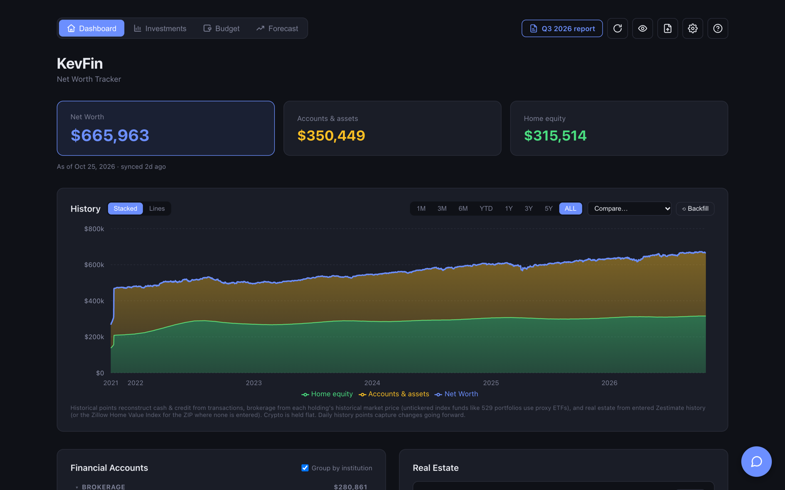

Every number in these pictures is made-up demo data.

---

## Install it (about 5 minutes)

### 1. Download

### **[⬇️ Download KevFin](https://github.com/kxl3785/KevFin/releases/latest)**

Scroll down to **Assets** and click the file for your computer:

- **Mac:** the file ending in **`.dmg`**
- **Windows:** the file ending in **`.exe`**

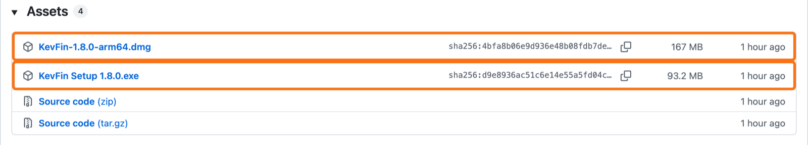

> **Which Mac do I have?** Click the Apple menu  → **About This Mac**. If it
> says **Chip: Apple M1** (or M2, M3, M4 and so on), you're set. Macs with an
> Intel chip aren't supported by the download; see [Other ways to run it](#other-ways-to-run-it).

### 2. Install

**On a Mac**

1. Double-click the `.dmg` file you downloaded.
2. Drag the **KevFin** icon into the **Applications** folder.
3. Open **Applications** and double-click **KevFin**.
4. The first time, your Mac may say it can't check the app for malware. That's
   because KevFin isn't sold through the App Store. To open it anyway:
   - Open **System Settings → Privacy & Security**, scroll down, and click
     **Open Anyway** next to the KevFin message.
   - On older versions of macOS, you can instead right-click KevFin in
     Applications and choose **Open**, then **Open** again.

You only need to do step 4 once.

**On Windows**

1. Double-click the `KevFin Setup` file you downloaded.
2. If a blue box says **"Windows protected your PC,"** click **More info**, then
   **Run anyway**. This appears because KevFin is a small independent app, not
   because anything is wrong.
3. Follow the installer. KevFin opens when it's done, and you'll find it in the
   Start menu afterward.

### 3. Open KevFin

A welcome guide walks you through the basics the first time you open it. You can
bring it back any time from the **⚙ gear** in the top-right corner.

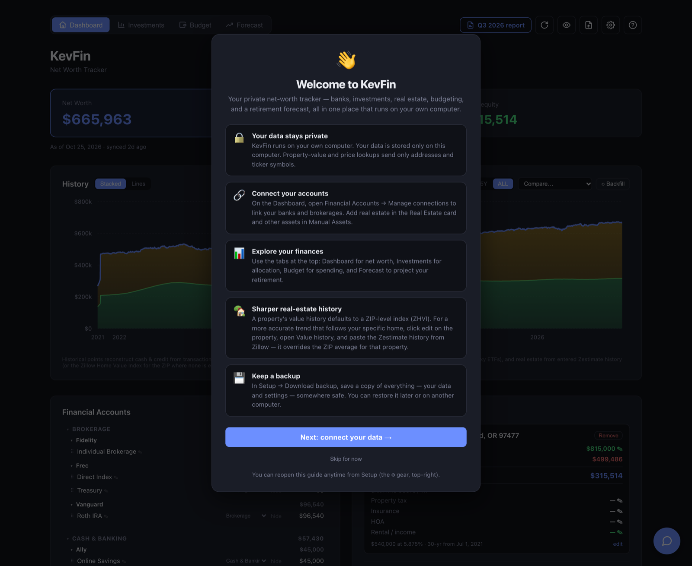

---

## Connect your accounts

KevFin needs a "connector" service to read your balances and transactions from
your bank. You only need **one** of these:

| | **SimpleFIN** (easiest) | **Plaid** (free) |
| --- | --- | --- |
| Cost | Small yearly subscription | Free for personal use |
| Setup | Copy and paste one code | Sign up as a "developer," then copy two keys |
| Works with | Most US banks and brokerages | Most US banks and brokerages, sometimes ones SimpleFIN can't reach |

You sign up with the connector yourself, so the connection belongs to you, not to
KevFin.

### Option A: SimpleFIN

1. Make an account at **[SimpleFIN Bridge](https://beta-bridge.simplefin.org/)**
   and connect your banks there.
2. On your **[SimpleFIN account page](https://beta-bridge.simplefin.org/my-account)**,
   click to create a **setup token**, then copy it.
3. In KevFin, go to the **Dashboard**, scroll to **Financial Accounts**, and click
   **Manage connections**.
4. Click **+ SimpleFIN**, paste the token, and click **Connect**.

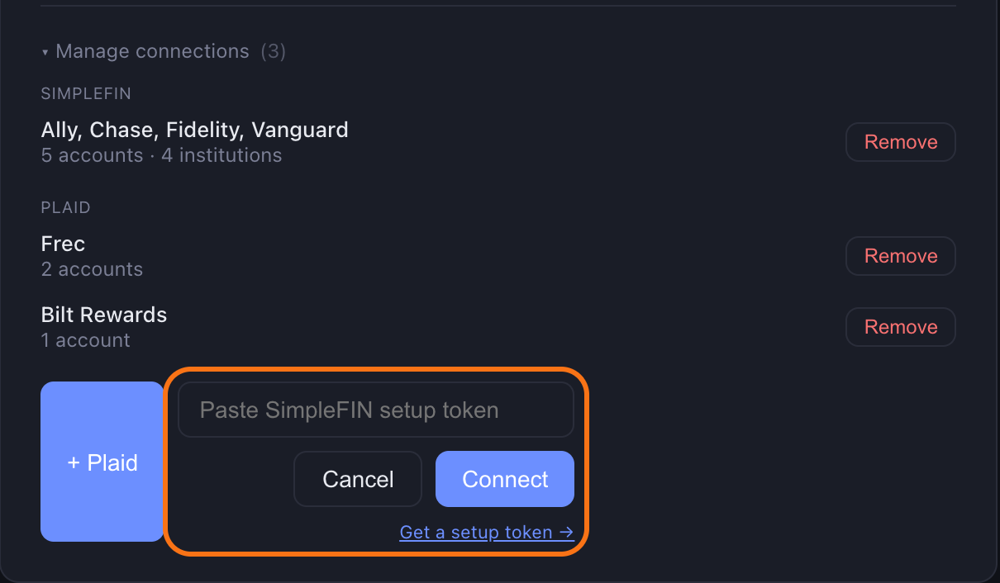

Your accounts appear in a few seconds.

### Option B: Plaid

1. Make a free **[Plaid account](https://dashboard.plaid.com/signup)** and ask for
   **production** access (Plaid allows it for personal use).
2. In Plaid, open **[Developers → Keys](https://dashboard.plaid.com/developers/keys)**
   and copy your **Client ID** and **production Secret**.
3. In KevFin, go to **Dashboard → Financial Accounts → Manage connections** and
   click **+ Plaid**.
4. Paste both keys, click **Save**, then pick your bank in the window that opens.

### Add your home (optional)

In the **Real Estate** box on the Dashboard, type your address and click
**+ Add Property**. KevFin looks up its value and, if you enter your mortgage,
works out your equity.

### Add anything else (optional)

Savings bonds, cash, a car, a private investment: add it under **Manual Assets**
at the bottom of the Dashboard.

---

## What you can do

### See your net worth grow

The **Dashboard** (pictured at the top of this page) adds everything up and draws a
chart of your net worth going back up to about five years.

### Look inside your investments

**Investments** shows what you actually own: stocks vs. bonds, which countries,
which industries, and how your accounts have performed. It looks through funds to
the companies inside them.

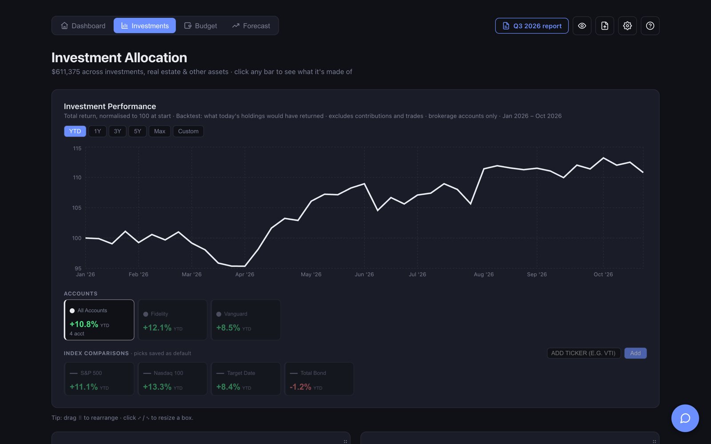

### Track your spending

**Budget** sorts your transactions into categories automatically, compares them
with your targets, and spots recurring bills.

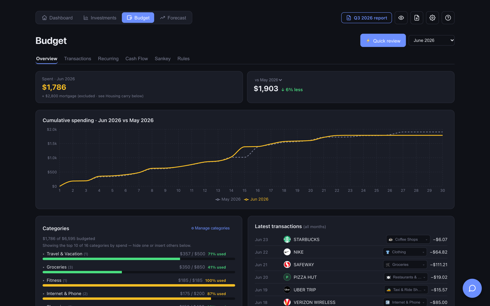

### Follow every dollar

The **Sankey** tab in Budget shows your money flowing from paychecks into
spending and savings. Click any band to see the transactions behind it.

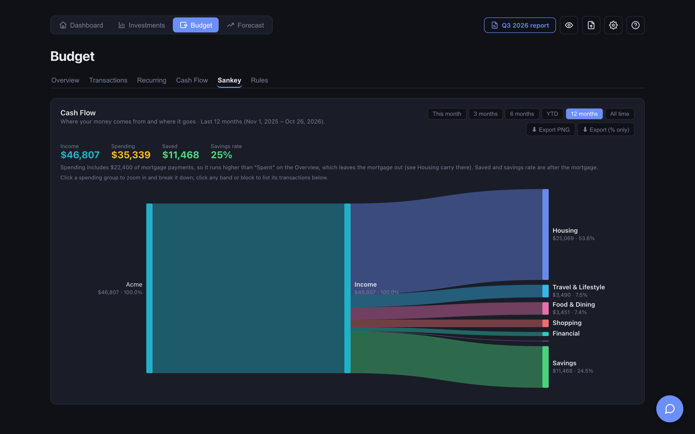

### Check if you're on track to retire

**Forecast** runs 400 possible futures for the stock market and tells you how
likely your money is to last. Drag the **What if…** sliders to see what happens
if you retire earlier, spend less, or save more.

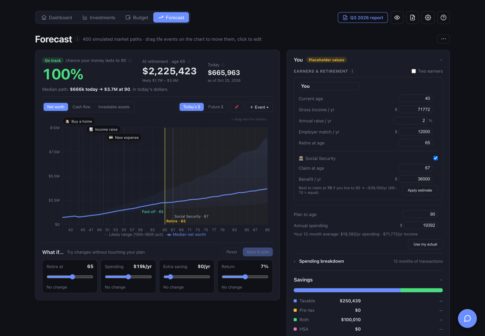

The **Cash flow** view shows the years you're saving (blue) and the years you're
living off your savings (orange).

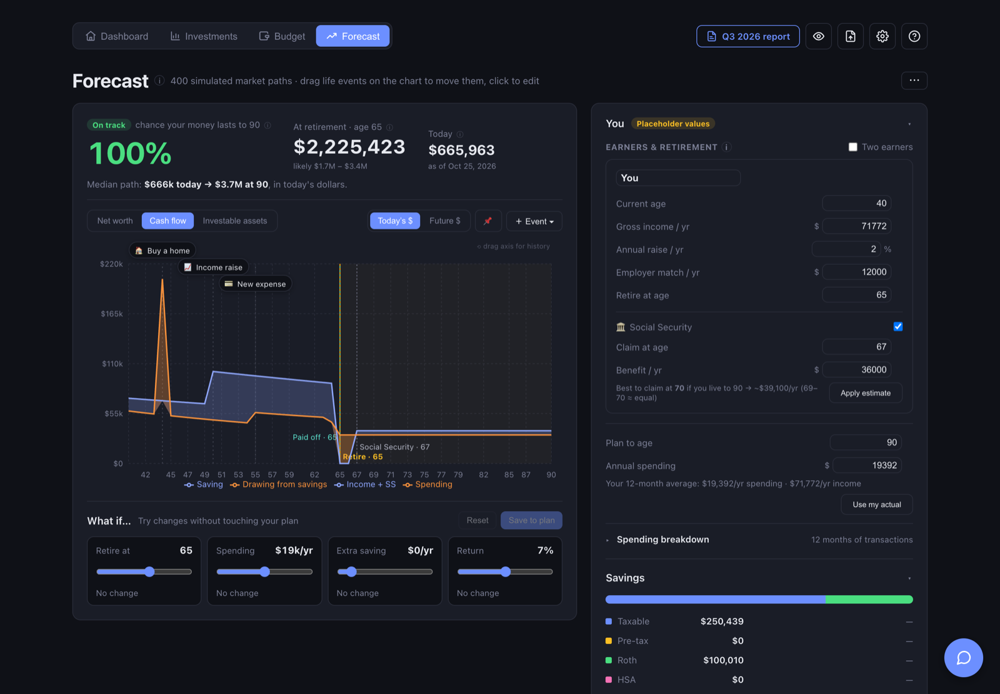

### Hide the numbers

Showing someone your screen? Click the **👁 eye** button at the top and every
dollar amount is hidden.

### Use it on your phone

The layout works on a phone screen too.

  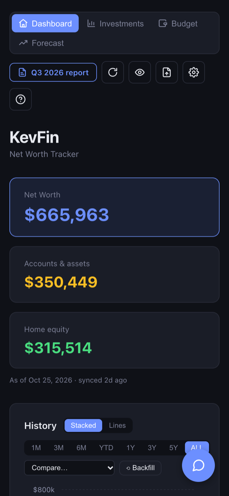
  &nbsp;&nbsp;
  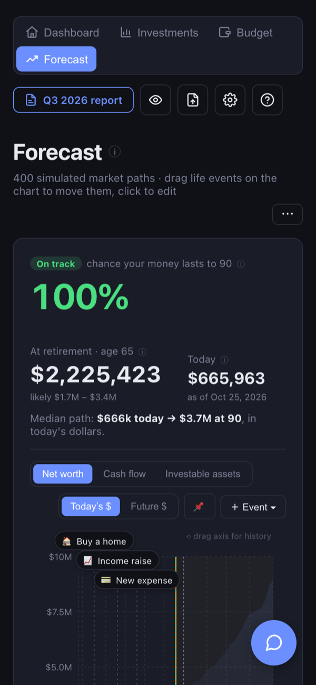

### Ask questions in plain English (optional)

If you have a Claude subscription, KevFin's chat button (bottom-right) can answer
questions like "How much did I spend on restaurants this year?" It uses the
[Claude Code](https://docs.claude.com/en/docs/claude-code/overview) app on your
computer and your own Claude login. Click the chat button and follow the
**Log in to Claude** steps.

---

## Keep a backup

Click the **⚙ gear** (top-right) and choose **Download backup**. Save the file
somewhere safe. If you ever get a new computer, install KevFin there and choose
**Restore from backup**.

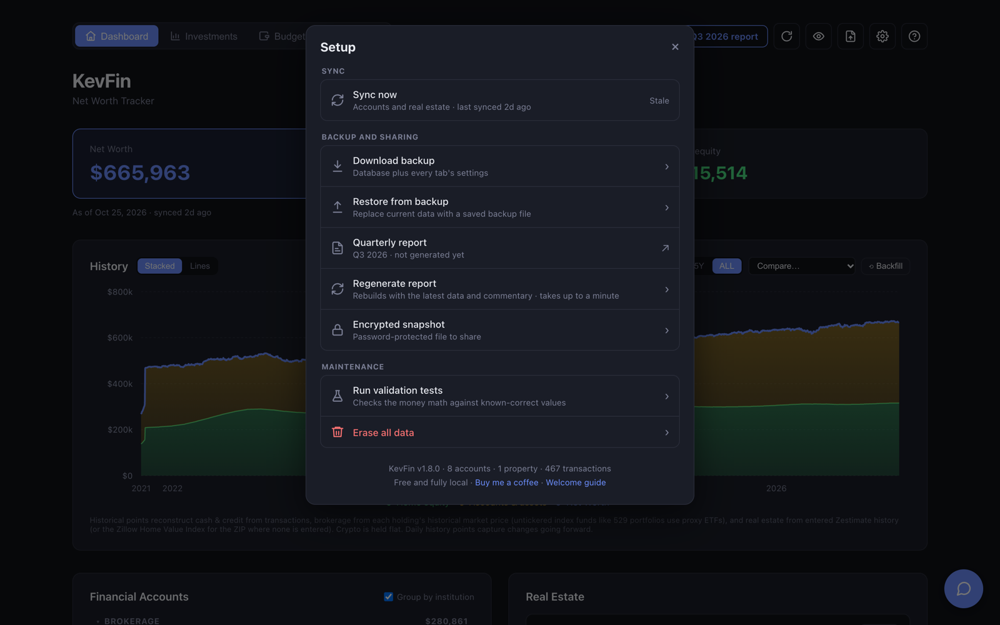

## Updating

Download the newest version from the
[same download page](https://github.com/kxl3785/KevFin/releases/latest) and install
it over the old one. Your data stays where it is.

---

## Questions

**Is my financial data private?**
Yes. Everything is stored on your computer. KevFin only goes online to fetch
your balances from the connector you chose, look up your home's value (it sends
the address), and get stock prices (it sends ticker symbols).

**Does it cost anything?**
KevFin is free. SimpleFIN charges a small yearly fee; Plaid is free for personal
use. The AI chat is optional and uses a Claude subscription you already have.

**Can I share my numbers with my spouse or advisor?**
Yes. In the **⚙ gear** menu, **Encrypted snapshot** makes a password-protected file
they can open in any web browser. It's a read-only copy; they can't change anything.

**Something looks wrong or broken.**
Please [open an issue](https://github.com/kxl3785/KevFin/issues) and describe what
you saw.

## Other ways to run it

Want KevFin running all the time on a home server or NAS (such as a Synology), so
everyone in the house can open it in a web browser? Using an Intel Mac or Linux?
Want to change the code? See the **[advanced guide](docs/ADVANCED.md)**.

## Support

KevFin is free. If it's useful to you, you can
[☕ buy me a coffee](https://www.buymeacoffee.com/kxl3785). Stars and bug reports
are just as appreciated.

## License

[MIT](LICENSE)
