# KevFin

**All your money in one place, and it stays on your computer.**

KevFin is a free app that puts your bank accounts, investments, credit cards and
home value on one screen. It shows your net worth over time, what's really inside
your investments, where your money goes each month, and whether you're on track to
retire. It runs on your own computer and keeps your data there: nothing is
uploaded unless you turn on and use the optional AI assistant.

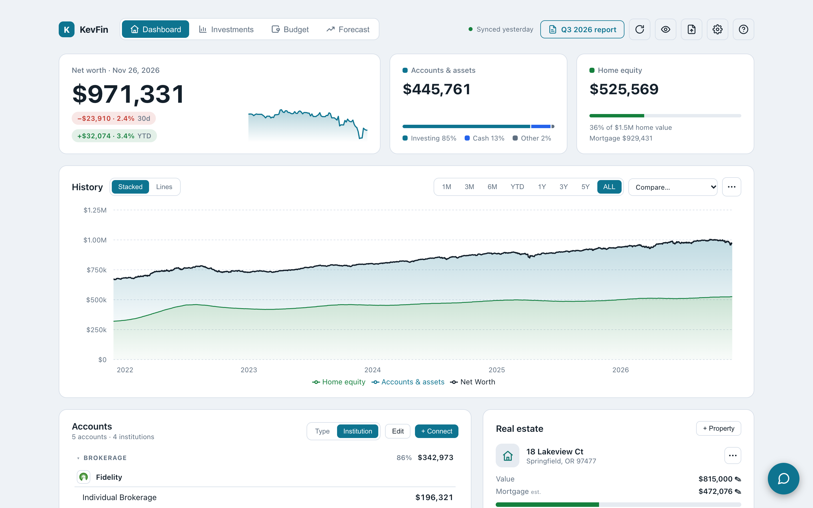

Every number in these pictures is made-up demo data.

---

## Install it (about 5 minutes)

### 1. Download

### **[⬇️ Download KevFin](https://github.com/kxl3785/KevFin/releases/latest)**

Scroll down to **Assets** and click the file for your computer:

- **Mac:** the file ending in **`.dmg`**
- **Windows:** the file ending in **`.exe`**

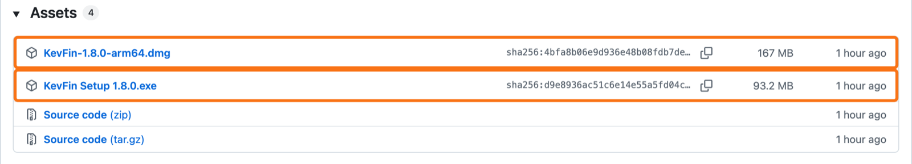

> **Which Mac do I have?** Click the Apple menu  → **About This Mac**. If it
> says **Chip: Apple M1** (or M2, M3, M4 and so on), you're set. Macs with an
> Intel chip aren't supported by the download; see [Other ways to run it](#other-ways-to-run-it).

### 2. Install

**On a Mac**

1. Double-click the `.dmg` file you downloaded.
2. Drag the **KevFin** icon into the **Applications** folder.
3. Open **Applications** and double-click **KevFin**.
4. The first time, your Mac may say it can't check the app for malware. That's
   because KevFin isn't sold through the App Store. To open it anyway:
   - Open **System Settings → Privacy & Security**, scroll down, and click
     **Open Anyway** next to the KevFin message.
   - On older versions of macOS, you can instead right-click KevFin in
     Applications and choose **Open**, then **Open** again.

You only need to do step 4 once.

**On Windows**

1. Double-click the `KevFin Setup` file you downloaded.
2. If a blue box says **"Windows protected your PC,"** click **More info**, then
   **Run anyway**. This appears because KevFin is a small independent app, not
   because anything is wrong.
3. Follow the installer. KevFin opens when it's done, and you'll find it in the
   Start menu afterward.

### 3. Open KevFin

The first time you open it, a one-screen welcome guide shows the three steps to
get going: connect your accounts, add your home, then look around. **Connect an
account** takes you straight to the place to do it. You can bring the guide back
any time from the **⚙ gear** in the top-right corner (**Welcome guide** at the
bottom).

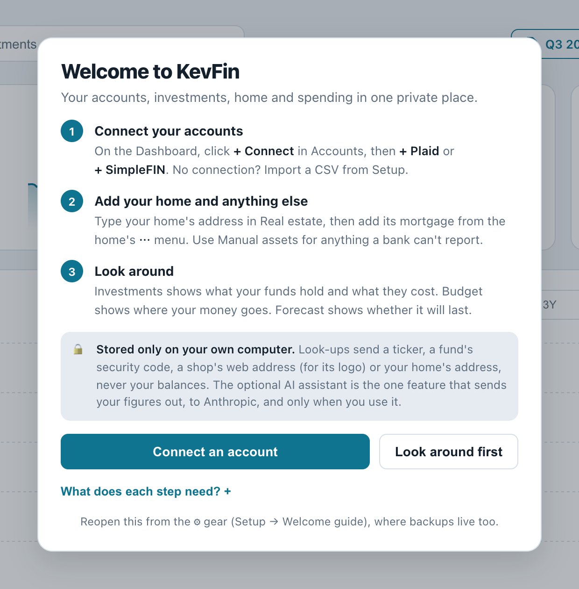

---

## Connect your accounts

KevFin needs a "connector" service to read your balances and transactions from
your bank. You only need **one** of these:

| | **SimpleFIN** (easiest) | **Plaid** (free) |
| --- | --- | --- |
| Cost | Small yearly subscription | Free for personal use |
| Setup | Copy and paste one code | Sign up as a "developer," then copy two keys |
| Works with | Most US banks and brokerages | Most US banks and brokerages, sometimes ones SimpleFIN can't reach |

You sign up with the connector yourself, so the connection belongs to you, not to
KevFin.

**Don't want a connector?** Click the **⚙ gear** and choose **Import transactions
from a CSV** for your spending (most banks let you download one), and type your
balances in under **Manual assets** on the Dashboard.

### Option A: SimpleFIN

1. Make an account at **[SimpleFIN Bridge](https://beta-bridge.simplefin.org/)**
   and connect your banks there.
2. On your **[SimpleFIN account page](https://beta-bridge.simplefin.org/my-account)**,
   click to create a **setup token**, then copy it.
3. In KevFin, go to the **Dashboard** and click **+ Connect** in the **Accounts**
   box.
4. Click **+ SimpleFIN**, paste the token, and click **Connect**.

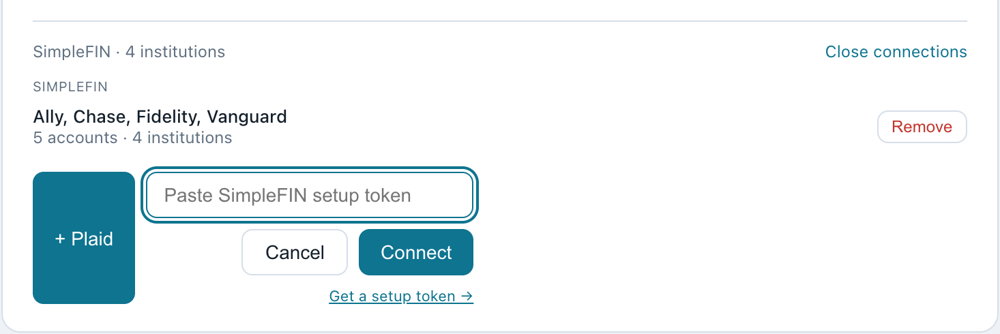

Your accounts appear in a few seconds.

### Option B: Plaid

1. Make a free **[Plaid account](https://dashboard.plaid.com/signup)** and ask for
   **production** access (Plaid allows it for personal use).
2. In Plaid, open **[Developers → Keys](https://dashboard.plaid.com/developers/keys)**
   and copy your **Client ID** and **production Secret**.
3. In KevFin, click **+ Connect** in the **Accounts** box on the Dashboard, then
   click **+ Plaid**.
4. Paste both keys, click **Save keys**, then pick your bank in the window that
   opens.

### Add your home (optional)

In the **Real estate** box on the Dashboard, click **+ Property**, type your
address and click **+ Add Property**. Then open the home's **⋯** menu and choose
**Add loan terms** to enter your mortgage, and KevFin works out your equity.

KevFin fills in the home's value by itself once you add a property-value key
(**Add a key →** under the address box). Without one, type the value in with the
**✎** pencil.

### Add anything else (optional)

Savings bonds, cash, a car, a private investment: click **+ Asset** in the
**Manual assets** box at the bottom of the Dashboard.

**Have a child's Trump Account?** No bank-linking service can read these yet, so
add it here as a manual asset with "Trump Account" in the name and update the
balance from the official app now and then. The retirement forecast then treats
it as your child's education money instead of counting it toward your own
retirement.

---

## What you can do

### See your net worth grow

The **Dashboard** (pictured at the top of this page) adds everything up and draws a
chart of your net worth going back up to about five years.

### Know what your home really costs

Each home on the Dashboard shows its equity, rate and payoff date. Click
**Carrying costs** for a yearly statement: what you pay (principal, interest, tax,
insurance), what you keep (the principal you paid down, and the home's growth from
its own five-year value history), and what owning it changes in your wealth.

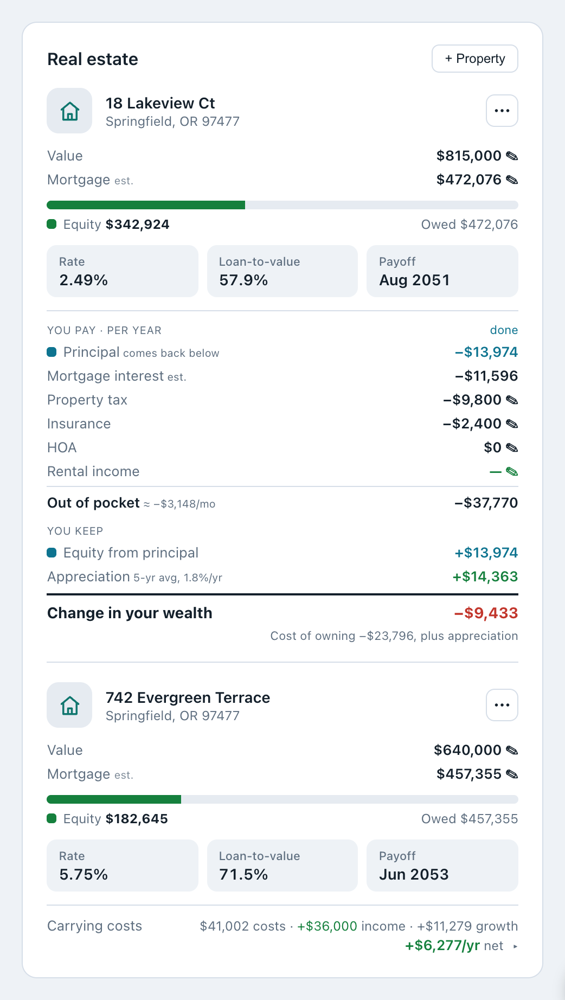

### Look inside your investments

**Investments** opens with your totals, then shows how your accounts have
performed, stocks vs. bonds against the mix you're aiming for (with the trades
that would bring you back), and which countries and industries you own.

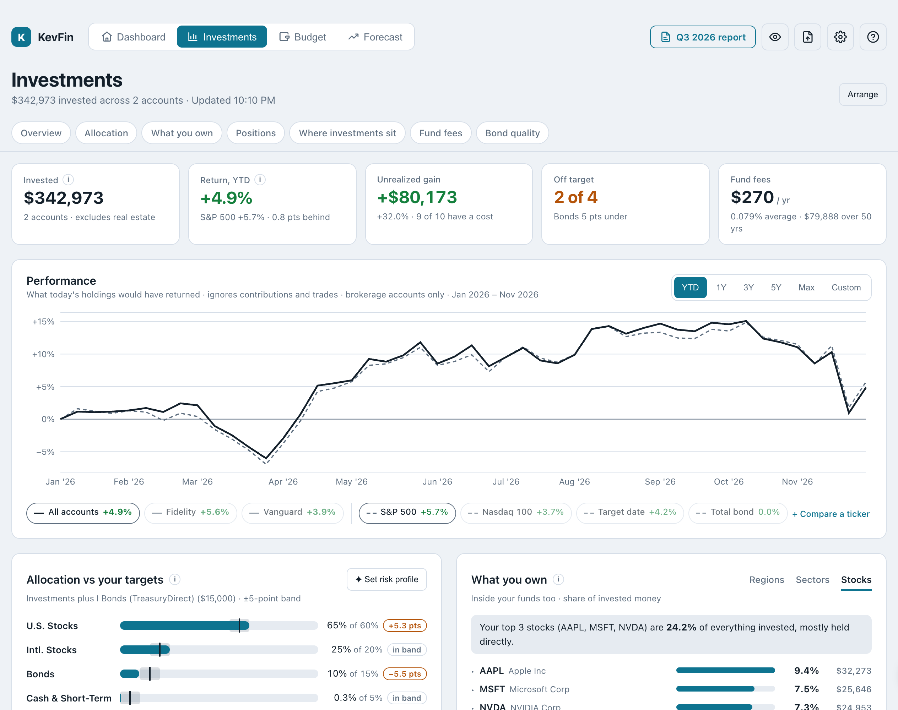

**What you own** looks through your funds to the companies inside them, so a
stock you hold directly and inside three funds shows up as one row. Click a
company to see where it comes from.

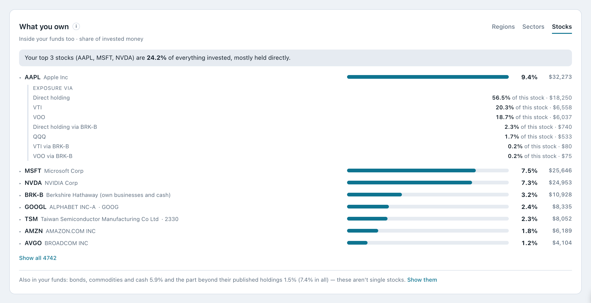

It also shows what your funds charge each year, which kinds of investment sit in
which kinds of account, and the quality of the bonds you own.

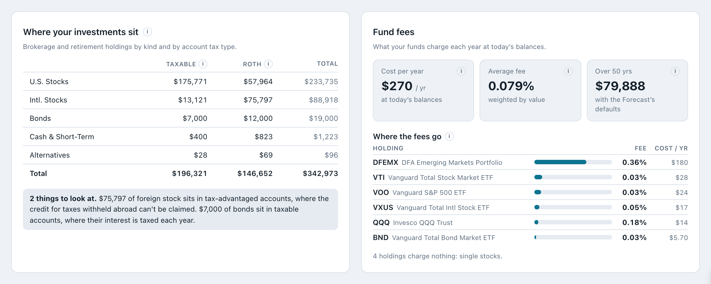

### Track your spending

**Budget** sorts your transactions into categories automatically, compares them
with your targets, and spots recurring bills. **Quick review** steps through the ones
it isn't sure about, a shop at a time: one click files them and makes a rule, so
next time they sort themselves. **Categories & rules** keeps all your rules in one
place.

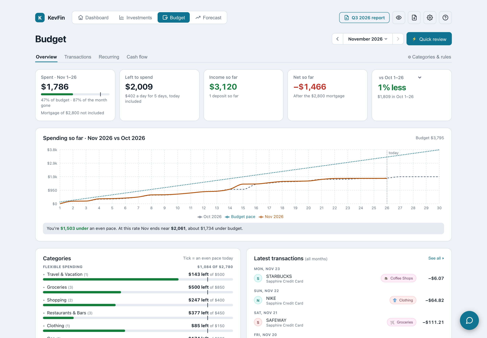

### Follow every dollar

In Budget, **Cash flow → Where it goes** shows your money flowing from paychecks
into spending and savings. Click any band to see the transactions behind it.

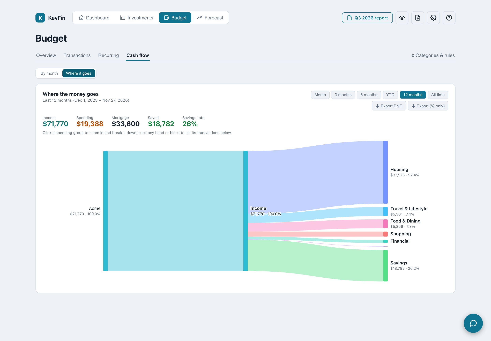

### Check if you're on track to retire

**Forecast** runs 400 possible futures for the stock market and tells you how
likely your money is to last, how much you could safely spend, and the earliest
age you could retire. Drag the **What if…** sliders to see what happens if you
retire earlier, spend less, or save more. Pin your plan (the **📌** button above
the chart) and the **Today against your plan** tile tracks how your real net
worth is doing against it.

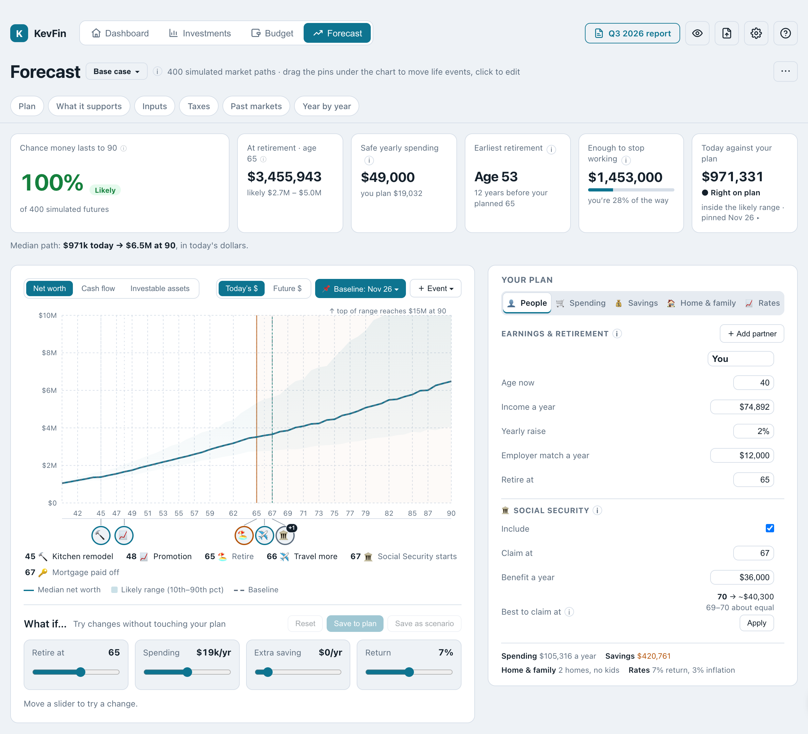

Save different plans as scenarios from the menu next to the **Forecast** title,
and tick **Compare** to draw them on the same chart, with a side-by-side table.

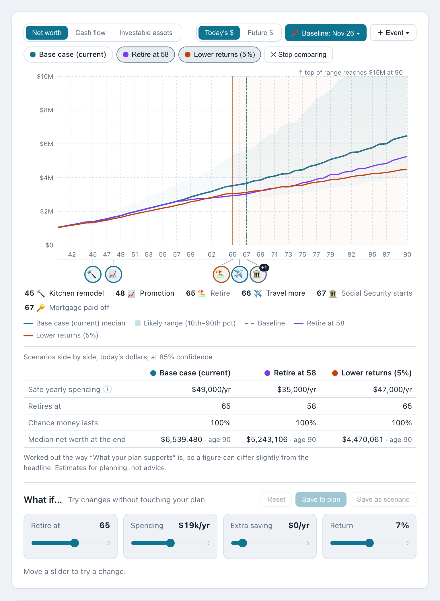

### Hide the numbers

Showing someone your screen? Click the **👁 eye** button at the top and every
dollar amount is hidden.

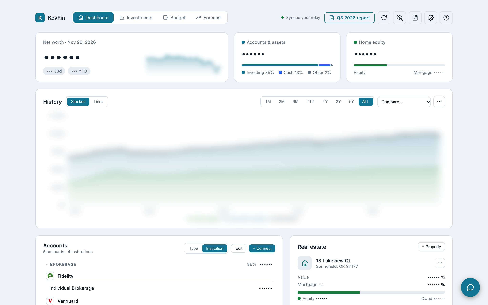

### Pick a theme

Click the **⚙ gear** (top-right) and choose a theme under **Appearance**:
**Midnight** (dark), **Mist** (cool light gray) or **Ember** (warm cream with a burnt-orange accent). It
changes instantly and follows you to every device.

<table>
  <tr>
    <td align="center">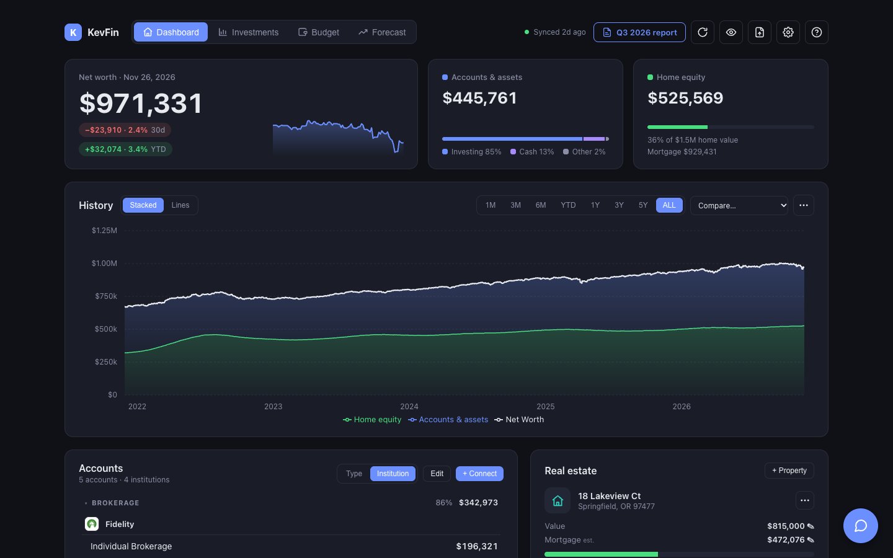 Midnight</td>
    <td align="center">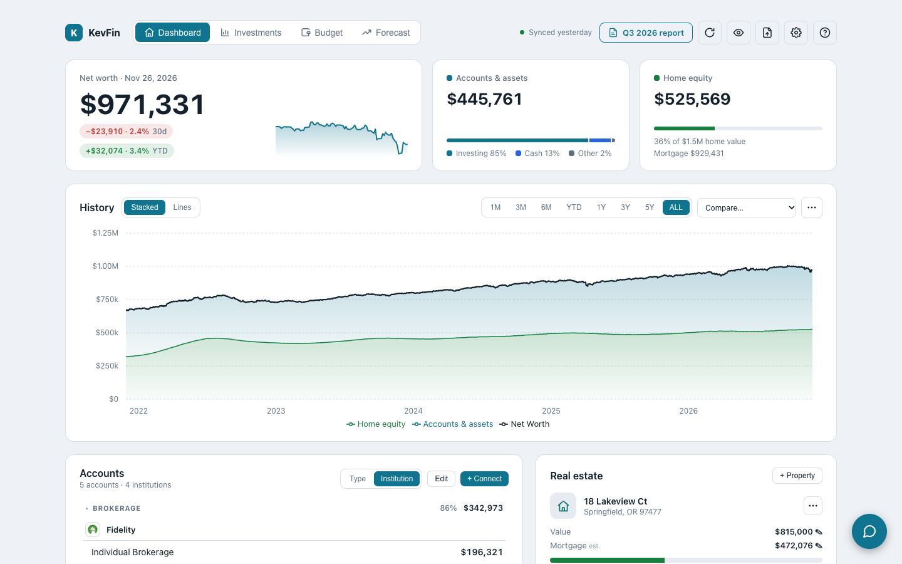 Mist</td>
    <td align="center">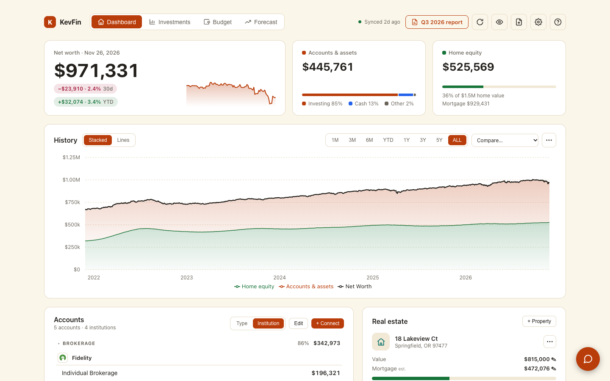 Ember</td>
  </tr>
</table>

### Use it on your phone

The layout works on a phone screen too.

  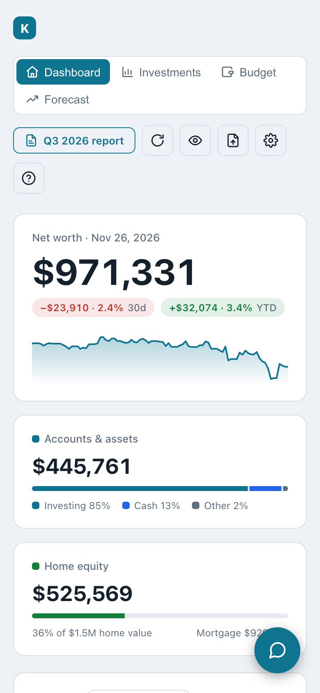
  &nbsp;&nbsp;
  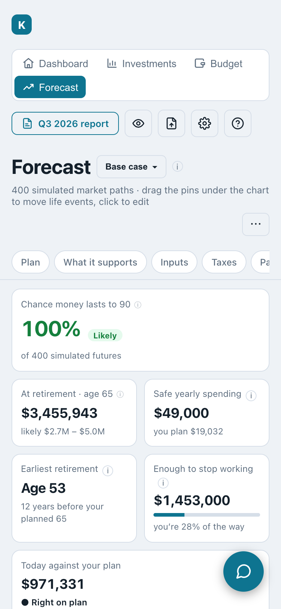

### Ask questions in plain English (optional)

If you have a Claude subscription, KevFin's chat button (bottom-right) can answer
questions like "How much did I spend on restaurants this year?" It uses the
[Claude Code](https://docs.claude.com/en/docs/claude-code/overview) app on your
computer and your own Claude login. Click the chat button and follow the
**Turn on the AI assistant** steps. Once it is on, you can also ask it how to set
KevFin up: connecting accounts, phone access, backups and updates.

---

## Keep a backup

Your data lives only on your computer, so keep a copy somewhere else. Click the
**⚙ gear** (top-right) and choose **Download backup**: one file with all your data
and settings. Save it somewhere safe, such as a USB stick or your cloud drive. If
you ever get a new computer, install KevFin there, click the **⚙ gear** and choose
**Restore from backup**. The same menu can also save your transactions, holdings
or net-worth history as a spreadsheet.

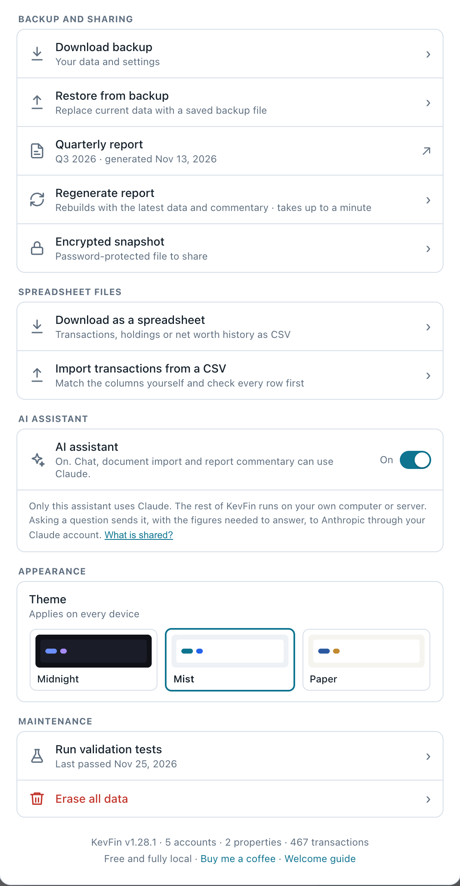

## Updating

Download the newest version from the
[same download page](https://github.com/kxl3785/KevFin/releases/latest) and install
it over the old one. Your data stays where it is.

---

## Questions

**Is my financial data private?**
Yes. Everything is stored only on your own computer. Apart from fetching your
balances from the connector you chose, KevFin's look-ups send a ticker symbol, a
fund's security code, a shop's web address (to show its logo) or your home's
address (to look up its value), never your balances. If you give an SEC contact
email in Setup, it goes only to the SEC (sec.gov), which asks for one before
sharing fund holdings.

The optional AI assistant is the one feature that sends your figures out, to
Anthropic, and only when you use it. Asking
it a question sends your question, a summary of your finances and any
transactions it looks up to Anthropic, through your own Claude account. It never
sends bank logins, tokens or keys, and your street address, email addresses,
phone numbers and long account numbers are masked first. Importing a document
sends that document, and the quarterly report sends summary figures. If you never
turn the assistant on, none of this happens. The chat has a **What is shared?**
link with the full list, and the **⚙ gear** menu has an **AI assistant** switch:
while it is off, nothing is sent to Claude.

**Does it cost anything?**
KevFin is free. SimpleFIN charges a small yearly fee; Plaid is free for personal
use. The AI chat is optional and uses a Claude subscription you already have.

**Can I share my numbers with my spouse or advisor?**
Yes. In the **⚙ gear** menu, **Encrypted snapshot** makes a password-protected file
they can open in any web browser. It's a read-only copy; they can't change anything.

**Something looks wrong or broken.**
Please [open an issue](https://github.com/kxl3785/KevFin/issues) and describe what
you saw.

## Other ways to run it

Want KevFin running all the time on a home server or NAS (such as a Synology), so
everyone in the house can open it in a web browser? Using an Intel Mac or Linux?
Want to change the code? See the **[advanced guide](docs/ADVANCED.md)**.

## Support

KevFin is free. If it's useful to you, you can
[☕ buy me a coffee](https://www.buymeacoffee.com/kxl3785). Stars and bug reports
are just as appreciated.

## License

[MIT](LICENSE)
